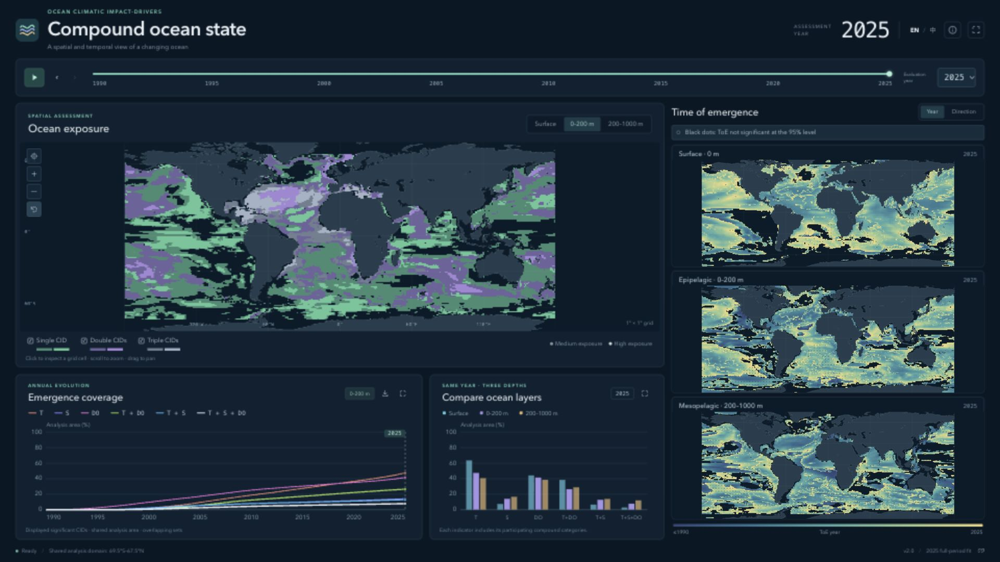

# Compound Ocean CIDs Explorer

一个可直接部署到 GitHub Pages 的海洋复合 CID 交互大屏。网页使用真实年度 NC 发布数据，包含 1990—2025 年、三个深度层的全球地图，以及按球面格点面积计算的六指标统计。

## 本地打开

在此目录运行：

    python3 -m http.server 8765 --bind 127.0.0.1

浏览器访问 [http://127.0.0.1:8765/](http://127.0.0.1:8765/)。

网页通过 HTTP 读取年度数据，不使用双击 HTML 的 file 地址。运行网页本身无需安装 npm 包、Python 科学计算库或地图服务。

默认评估年份为 2025 年，默认暴露度深度为 0—200 m，默认英文。语言选择会在当前浏览器保存。

## 使用

- 拖动标题下方的时间轴、选择年份或点击时间序列中的年份，更新四张地图和柱状图。
- 点击播放，从当前年份逐年推进；在 2025 年点击播放会回到 1990 年，到 2025 年自动停止。
- 主图切换表层、0—200 m、200—1000 m；时间序列使用相同深度。
- 右侧三张 ToE 地图同时切换年份着色或方向着色。
- 点击任意地图查询格点，在全部地图同步标记，并显示三个深度层的结果。
- 使用主图左上角的定位按钮输入经纬度。西经和南纬输入负数。
- 滚轮缩放、拖动平移；地图键盘支持方向键平移、加减号缩放、Enter 查询中心位置。
- 主图图例控制单、双、三因子显示；六曲线图例控制相应曲线及柱状图指标显示。
- 图表右上角可放大；CSV 按钮下载 648 条面积统计。
- 复制链接保留评估年份、深度、ToE 着色模式、语言和所选格点。

## 部署到 GitHub Pages

默认只使用 GitHub 账号 zqtzt。将本目录内容上传到该账号下的目标仓库，保留隐藏文件夹 .github 和空文件 .nojekyll。

1. 在仓库 Settings → Pages 中，将 Source 设为 GitHub Actions。
2. 推送到 main 或 master，或在 Actions 中手动运行 Deploy dashboard to GitHub Pages。
3. 工作流复制静态资源到 _site 并发布。无需重新运行科学计算。
4. 部署完成后，使用 Pages 返回的地址访问，例如 https://zqtzt.github.io/仓库名称/。

如果使用从分支发布的方式，也可将分支根目录作为发布源；.nojekyll 已包含在内。所有资源使用相对路径，支持仓库子目录部署。

网页不依赖第三方瓦片、在线字体、API 密钥或应用服务器。公开静态资源约 41 MiB，年度数据按需读取，每年约 1.11 MiB。

官方说明：[GitHub Pages](https://docs.github.com/en/pages/getting-started-with-github-pages/what-is-github-pages)、[自定义工作流](https://docs.github.com/en/pages/getting-started-with-github-pages/using-custom-workflows-with-github-pages)。

## 科学口径

地图来自 v2.0 年度发布文件，拟合锚点为 2025 年；年度 NC 不在导出过程中改写。

原始暴露等级数值只在程序内部解码，界面使用其物理含义或“—”。
按当前展示约定，低暴露区域使用海洋底色，不显示低暴露色块；查询中的暴露等级与暴露类型显示“—”。中等暴露和高暴露使用文字含义。已有 ToE、方向和显著性仍可查询。
黑点表示 ToE 在 95% 水平下不显著，说明固定放在 ToE 标题下方；悬浮提示与查询面板均显示显著性。

统计域从本批 1980 年发布文件的有限暴露格点提取并冻结，包含 35,706 个水面格点，格点中心纬度为 69.5°S—67.5°N，面积约 346,338,596.06 km²。1980 年文件仅用于建立固定掩膜，不作为网页可选年份。

格点面积使用球面边界积分：

    A = R² × Δλ × [sin(北边界纬度) − sin(南边界纬度)]
    R = 6371.0088 km，所有角度转换为弧度

每项指标的分子为固定统计域内 ToE 有效且 ToE 显著性标记通过的相应已展示类别面积。分母在所有年份、所有深度保持一致。地图允许查看统计域外的发布值，查询面板会指出其是否纳入面积统计。

六个指标为包含关系的重叠集合：

| 指标 | NC 方向类别 |
|---|---|
| T | 1、5、6、7、8、9 |
| S | 2、3、5、6、8、9 |
| DO | 4、7、8、9 |
| T＋DO | 7、8、9 |
| T＋S | 5、6、8、9 |
| T＋S＋DO | 8、9 |

T 对应增暖；S 包括盐化和淡化；DO 对应脱氧。三因子区域同时计入全部包含它的集合，百分比不能相加。这是已展示显著类别的覆盖统计，不是独立变量成员统计的中位数；不从 0/1 判定标记推算置信带。

### 低暴露与缺测值

v2.0 的低暴露发布编码合并了分析纬带内原本未指派暴露等级的水面格点，包含未评估、支持不足或未纳入映射的情形。未指派类型保持为空，不能从 ToE 类别替它补充暴露类型。网页保留这一区分，并在数据说明中提供定义。

未通过 ToE 判定与未评估分别显示；缺测 ToE 不改为零年。ToE 显著性判定不作为暴露度的额外筛选条件。

## 文件结构

- index.html、styles.css、app.js：界面、状态和控件。
- maps.js：四张 Canvas 地图、缩放平移和格点定位。
- charts.js：SVG 时间序列及分组柱状图。
- data.js、i18n.js：年度数据读取、解码、双语定义。
- data/grid：36 个年度二进制网格文件。
- data/statistics.json、annual_coverage.csv：六项指标的面积与占比。
- data/domain.bin、coastline.json：固定统计域和海岸背景几何。
- data/manifest.json：格式、来源 SHA256、分类约定和处理元数据。
- scripts：数据导出、独立核验、静态打包。
- tests：经纬度、缺测值、类别、标签和面积关系测试。

海岸背景仅从原项目 M_Map 的 m_coasts.mat 导出几何，未打包 M_Map 程序。其来源及 SHA256 记录在 coastline.json 中。

## 更新与验证数据

科学数据转换需要 numpy 和 scipy；可在已有科学 Python 环境运行，或安装 requirements-data.txt。

    python scripts/prepare_data.py --source /年度NC目录 --coastline /M_Map/private/m_coasts.mat
    python scripts/validate_data.py --source /年度NC目录 --report validation.json
    node --test tests/data.test.mjs
    python3 scripts/build_site.py

prepare_data.py 只接受已确认的 1990—2025 年 v2.0 发布产品及 2025 年拟合锚点，保留经度顺序、缺测值和原始类别。未来改变发布范围或版本时，应一起更新程序边界、元数据和界面。

独立验证器逐值对比全部 34,992,000 个科学格点值，并直接解码 NC 的 flag_meanings，通过另一种等价面积公式复算全部 648 个覆盖比例。

### 已核对样例

2025 年，25.5°N、39.5°W，0—200 m：

- ToE：1996 年。
- 方向：增暖＋盐化。
- ToE 95% 判定：通过。
- 暴露等级：High exposure／高暴露。
- 暴露类型：温度＋盐度。

2025 年 0—200 m 的六指标覆盖率约为 T 47.46%、S 14.09%、DO 41.45%、T＋DO 26.45%、T＋S 12.87%、T＋S＋DO 7.75%。

## 数据关联论文

沿用 NC 中记录的数据引用。关联论文：[Observed large-scale and deep-reaching compound ocean state changes over the past 60 years](https://www.nature.com/articles/s41558-025-02484-x)。
